# Vendora — System Design

> **Project:** Vendora  
> **Architecture:** Client–Server Architecture with Modular Monolith 

---

# Table of Contents

1. [Introduction](#1-introduction)
2. [Architecture Overview](#2-architecture-overview)
3. [Architectural Decisions](#3-architectural-decisions)
4. [Technology Stack](#4-technology-stack)
5. [Client Architecture](#5-client-architecture)
6. [Server Architecture](#6-server-architecture)
7. [Client–Server Communication](#7-clientserver-communication)
8. [Functional Architecture](#8-functional-architecture)
9. [Authentication and Authorization](#9-authentication-and-authorization)
10. [Payment Gateway Architecture](#10-payment-gateway-architecture)
11. [Database Architecture](#11-database-architecture)
12. [API Architecture](#12-api-architecture)
13. [Security Architecture](#13-security-architecture)
14. [Caching and Background Processing](#14-caching-and-background-processing)
15. [Scalability and Performance](#15-scalability-and-performance)
16. [DevOps and Infrastructure](#16-devops-and-infrastructure)
17. [Monitoring and Logging](#17-monitoring-and-logging)
18. [Testing Strategy](#18-testing-strategy)
19. [Error Handling](#19-error-handling)
20. [Project Folder Structure](#20-project-folder-structure)
21. [Implementation Roadmap](#21-implementation-roadmap)
22. [Future Enhancements](#22-future-enhancements)
23. [Engineering Standards](#23-engineering-standards)

---

# 1. Introduction

## 1.1 Project Overview

Vendora is a full-stack e-commerce application designed to provide a secure, scalable, and maintainable online shopping platform.

The platform enables customers to browse products, manage shopping carts, place orders, complete payments, and track their purchases.

Administrators can manage products, categories, inventory, customers, orders, discounts, and platform analytics.

## 1.2 Primary Objectives

- Build a production-ready e-commerce platform.
- Maintain strict separation between client and server.
- Implement secure authentication and authorization.
- Provide reliable payment processing.
- Maintain accurate inventory and order consistency.
- Design modular and maintainable backend architecture.
- Support horizontal scalability.
- Establish automated testing and deployment workflows.

## 1.3 Architectural Principles

1. Separation of Concerns.
2. Single Responsibility Principle.
3. Modular Architecture.
4. Secure by Default.
5. Database Consistency.
6. API-First Development.
7. Stateless Application Servers.
8. Fail-Safe Error Handling.
9. Observability.
10. Incremental Scalability.

---

# 2. Architecture Overview

## 2.1 Architecture Style

Vendora follows a Client–Server Architecture with a Modular Monolithic Backend.

The system consists of two independently deployable applications:

- Client Application: React + TypeScript.
- Server Application: Node.js + Express.js.

The backend initially follows a modular monolithic architecture rather than microservices.

Each business domain is implemented as an independent module within the backend application.

## 2.2 High-Level Architecture

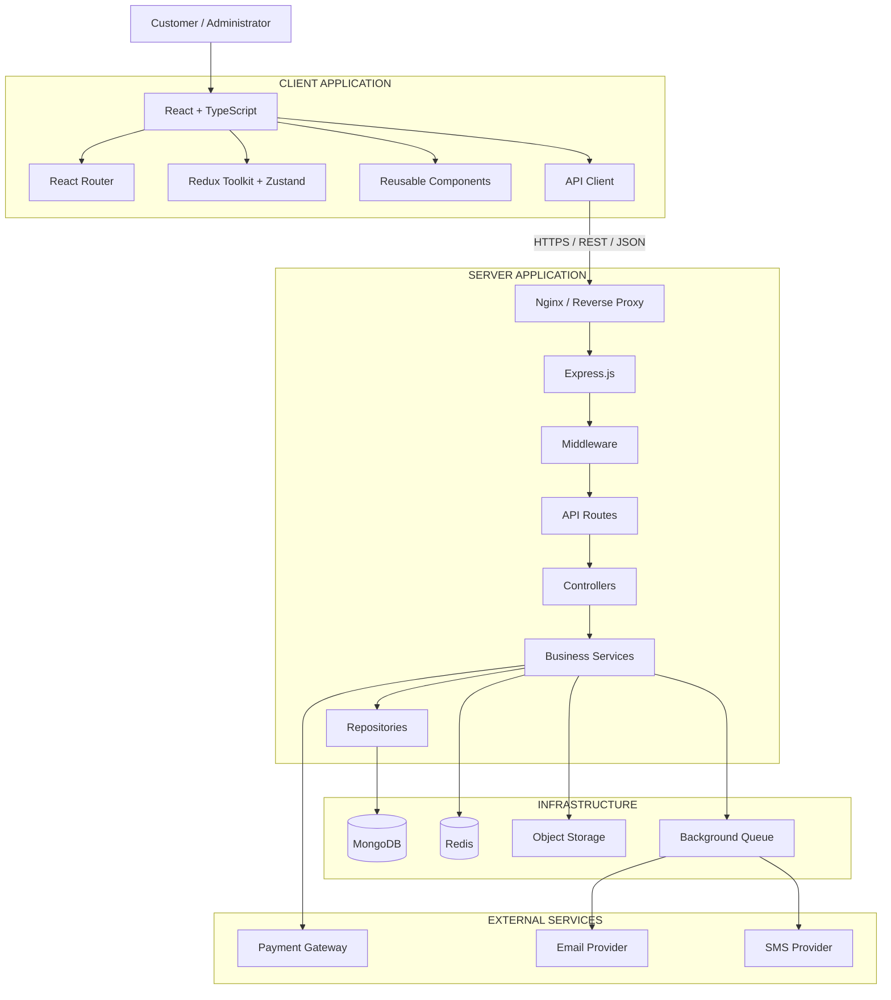

## 2.3 Component Responsibilities

| Component | Responsibility |
| --- | --- |
| React | User interface |
| TypeScript | Client-side type safety |
| Redux Toolkit | Shared application/server state |
| Zustand | Lightweight UI state |
| Express.js | HTTP request handling |
| Middleware | Authentication, authorization, validation |
| Controllers | Request and response handling |
| Services | Business logic |
| Repositories | Database operations |
| MongoDB | Persistent data storage |
| Redis | Caching and queue infrastructure |
| Payment Gateway | Payment processing |
| Object Storage | Product images and documents |

## 2.4 Request Lifecycle

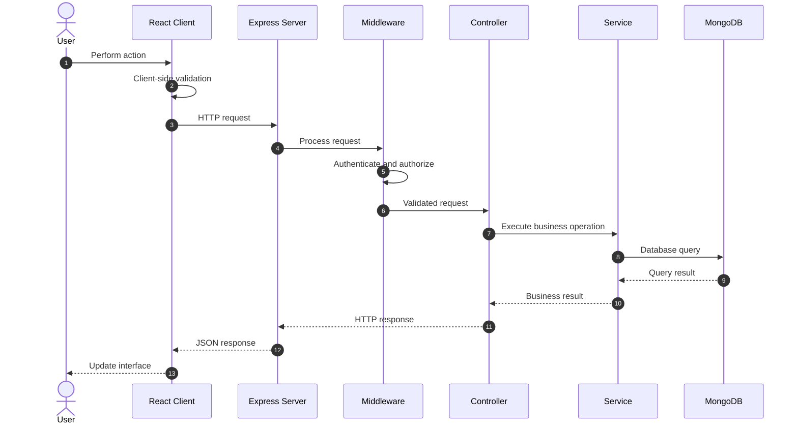

---

# 3. Architectural Decisions

## 3.1 Monolith vs Microservices

Vendora will initially use a Modular Monolith.

| Criteria | Modular Monolith | Microservices |
| --- | --- | --- |
| Deployment | Single backend deployment | Multiple deployments |
| Development | Simpler | More complex |
| Database transactions | Easier | Distributed complexity |
| Communication | Internal function calls | Network communication |
| Infrastructure | Lower operational cost | Higher operational cost |
| Scaling | Application-level scaling | Independent service scaling |
| Maintenance | Easier initially | Requires mature operations |

### Decision

Use a Modular Monolith for the initial production release.

The backend will maintain independent modules for:

- Authentication
- Users
- Products
- Categories
- Cart
- Wishlist
- Inventory
- Checkout
- Orders
- Payments
- Coupons
- Reviews
- Notifications
- Administration

These modules will communicate through clearly defined service interfaces.

Microservices can be introduced when independent scaling, team ownership, deployment frequency, or fault isolation justifies the additional complexity.

## 3.2 Database Decision

MongoDB with Mongoose will remain the primary database.

Reasons:

- Existing Vendora implementation already uses MongoDB.
- Flexible product catalog structures.
- Document-oriented data modeling.
- Mongoose validation and middleware.
- Transactions supported on replica sets.
- Horizontal scaling through sharding when required.

Redis will be introduced for caching and background job infrastructure.

---

# 4. Technology Stack

## 4.1 Frontend

| Technology | Purpose |
| --- | --- |
| React | UI development |
| TypeScript | Static type safety |
| Vite | Development and build tooling |
| React Router | Client routing |
| Redux Toolkit | Shared application state |
| Zustand | UI state |
| Axios | HTTP communication |
| Zod | Client-side validation |
| Tailwind CSS | Styling, if retained by the frontend |
| Vitest | Unit testing |
| Playwright | End-to-end testing |

## 4.2 Backend

| Technology | Purpose |
| --- | --- |
| Node.js | Runtime |
| Express.js | Backend framework |
| JavaScript ES Modules | Module system |
| MongoDB | Primary database |
| Mongoose | ODM |
| Zod | Request validation |
| JWT | Authentication |
| bcrypt | Password hashing |
| Redis | Caching |
| BullMQ | Background jobs |
| Winston / Pino | Structured logging |
| Jest / Vitest | Testing |

## 4.3 Infrastructure

| Technology | Purpose |
| --- | --- |
| Docker | Containerization |
| Docker Compose | Local development |
| Nginx | Reverse proxy |
| GitHub Actions | CI/CD |
| AWS / Azure / GCP | Cloud infrastructure |
| Cloudflare | CDN and WAF |
| S3-compatible storage | Media storage |
| MongoDB Atlas | Managed MongoDB |
| Redis | Managed cache and queue |

## 4.4 Payment Gateway

Initial recommendation:

- Razorpay for Indian customers.
- Stripe as a possible future international payment provider.

Payment integration must be implemented behind a provider-independent adapter.

---

# 5. Client Architecture

## 5.1 Client Responsibilities

The client application is responsible for:

- Rendering the storefront.
- Displaying products and categories.
- Managing user interactions.
- Managing navigation.
- Handling forms.
- Performing immediate client-side validation.
- Communicating with backend APIs.
- Displaying loading and error states.
- Managing UI state.
- Displaying order and payment status.

The client must never be trusted for:

- Product pricing.
- Discount calculations.
- Inventory availability at purchase time.
- Payment verification.
- Order status transitions.
- Administrative authorization.

All authoritative business rules must be enforced by the backend.

## 5.2 Client Architecture Diagram

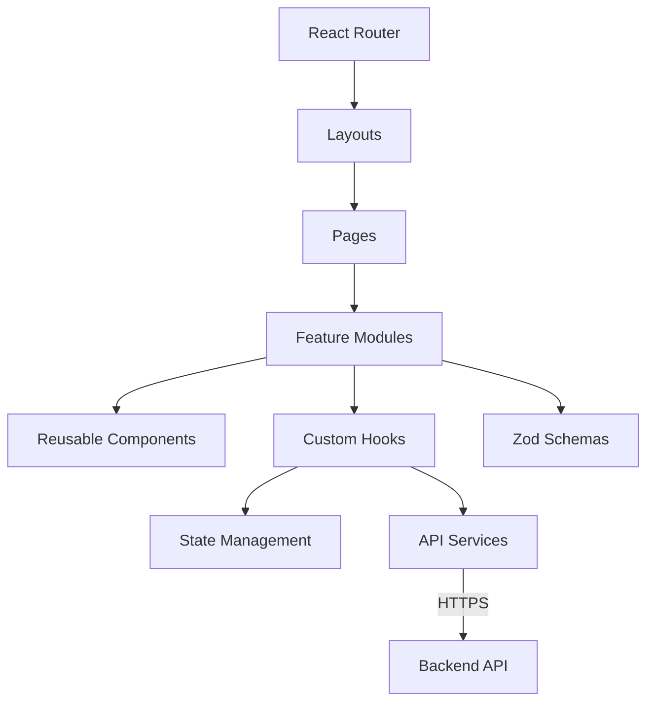

## 5.3 Client Modules

### Authentication

- Login
- Registration
- Logout
- Refresh session
- Password reset
- Protected routes

### Product Catalog

- Product listing
- Product details
- Search
- Filtering
- Sorting
- Pagination

### Shopping

- Shopping cart
- Wishlist
- Quantity management
- Checkout
- Address selection

### Account

- User profile
- Address management
- Order history
- Order details
- Reviews

### Administration

- Dashboard
- Product management
- Category management
- Order management
- Inventory management
- User management
- Coupon management
- Analytics

## 5.4 Client Folder Structure

```text
client/
├── public/
├── src/
│   ├── app/
│   │   ├── App.tsx
│   │   ├── router.tsx
│   │   ├── providers.tsx
│   │   └── store.ts
│   ├── assets/
│   ├── components/
│   │   ├── ui/
│   │   └── common/
│   ├── features/
│   │   ├── auth/
│   │   │   ├── api/
│   │   │   ├── components/
│   │   │   ├── hooks/
│   │   │   ├── schemas/
│   │   │   ├── types/
│   │   │   └── pages/
│   │   ├── products/
│   │   ├── categories/
│   │   ├── cart/
│   │   ├── wishlist/
│   │   ├── checkout/
│   │   ├── orders/
│   │   ├── payments/
│   │   ├── profile/
│   │   ├── reviews/
│   │   └── admin/
│   ├── hooks/
│   ├── layouts/
│   ├── lib/
│   │   ├── api-client.ts
│   │   ├── errors.ts
│   │   └── formatters.ts
│   ├── services/
│   ├── state/
│   ├── styles/
│   ├── types/
│   └── main.tsx
├── tests/
├── .env.example
├── package.json
└── vite.config.ts
```

## 5.5 Client Routes

| Route | Access |
| --- | --- |
| `/` | Public |
| `/products` | Public |
| `/products/:slug` | Public |
| `/categories/:slug` | Public |
| `/login` | Guest |
| `/register` | Guest |
| `/cart` | Customer |
| `/checkout` | Customer |
| `/account/profile` | Customer |
| `/account/orders` | Customer |
| `/account/orders/:id` | Order owner |
| `/admin` | Admin |
| `/admin/products` | Admin |
| `/admin/categories` | Admin |
| `/admin/orders` | Admin |
| `/admin/users` | Authorized admin |

Client-side route guards improve UX. They are not security boundaries. The server must enforce every permission independently.

---

# 6. Server Architecture

## 6.1 Server Responsibilities

The server is responsible for:

- Authentication and authorization.
- Business logic.
- Request validation.
- Database operations.
- Product management.
- Inventory management.
- Cart and wishlist persistence.
- Checkout calculations.
- Order creation.
- Payment processing.
- Refunds and cancellations.
- Notification delivery.
- Audit logging.
- Security enforcement.

## 6.2 Backend Architecture

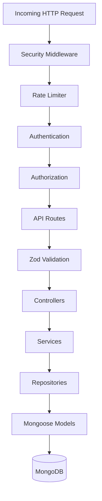

Authentication and authorization are conditional middleware: public routes do not require a user session, while protected routes require the relevant checks.

## 6.3 Backend Layers

| Layer | Responsibility |
| --- | --- |
| Routes | HTTP endpoint definitions |
| Middleware | Authentication, authorization, rate limiting |
| Validators | Request validation |
| Controllers | HTTP request and response handling |
| Services | Business logic |
| Repositories | Database operations |
| Models | Mongoose schemas |
| Integrations | External service adapters |
| Jobs | Background processing |
| Utils | Shared technical utilities |

### Routes

Define endpoints and middleware.

### Controllers

Receive requests, call services, and return responses.

Controllers must not contain complex business logic.

### Services

Contain business rules and orchestrate operations.

### Repositories

Encapsulate MongoDB queries and persistence.

### Models

Define document structures, indexes, and persistence constraints.

## 6.4 Backend Folder Structure

```text
server/
├── src/
│   ├── app.js
│   ├── server.js
│   ├── config/
│   │   ├── env.js
│   │   ├── database.js
│   │   ├── redis.js
│   │   └── logger.js
│   ├── routes/
│   │   └── index.js
│   ├── middleware/
│   │   ├── authenticate.js
│   │   ├── authorize.js
│   │   ├── validate.js
│   │   ├── rate-limit.js
│   │   ├── not-found.js
│   │   └── error-handler.js
│   ├── modules/
│   │   ├── auth/
│   │   ├── users/
│   │   ├── products/
│   │   ├── categories/
│   │   ├── cart/
│   │   ├── wishlist/
│   │   ├── inventory/
│   │   ├── addresses/
│   │   ├── coupons/
│   │   ├── checkout/
│   │   ├── orders/
│   │   ├── payments/
│   │   ├── reviews/
│   │   ├── notifications/
│   │   └── admin/
│   ├── integrations/
│   │   ├── payment/
│   │   ├── email/
│   │   ├── sms/
│   │   └── storage/
│   ├── queues/
│   ├── jobs/
│   ├── database/
│   ├── utils/
│   └── types/
├── tests/
│   ├── unit/
│   ├── integration/
│   └── fixtures/
├── Dockerfile
├── .env.example
└── package.json
```

Each module should own its routes, controller, service, validation, and data-access code.

Example:

```text
modules/products/
├── product.routes.js
├── product.controller.js
├── product.service.js
├── product.validation.js
├── product.model.js
└── product.repository.js
```

---

# 7. Client–Server Communication

## 7.1 Communication Protocol

Vendora uses REST APIs over HTTPS.

Production API:

```text
https://api.vendora.example.com/api/v1
```

Development API:

```text
http://localhost:5000/api/v1
```

The client communicates with the server using JSON.

## 7.2 API Request Lifecycle

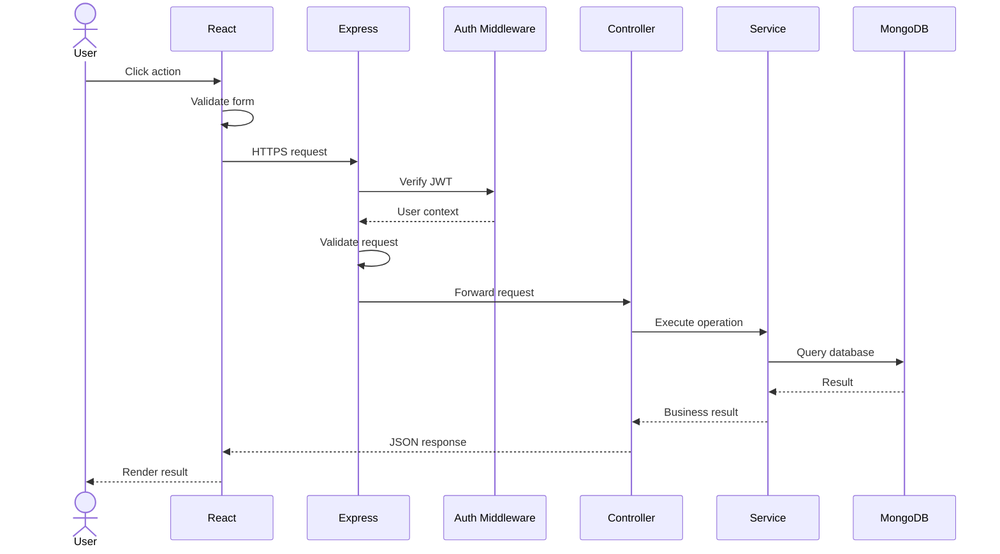

## 7.3 Standard Success Response

```json
{
    "success": true,
    "data": {
        "id": "665f1a2b3c4d5e6f78901234",
        "name": "Example Product"
    },
    "meta": null
}
```

## 7.4 Standard Error Response

```json
{
    "success": false,
    "error": {
        "code": "VALIDATION_ERROR",
        "message": "Invalid request data.",
        "details": [
            {
                "field": "email",
                "message": "Enter a valid email address."
            }
        ],
        "requestId": "req_123"
    }
}
```

## 7.5 HTTP Status Codes

| Code | Description |
| --- | --- |
| 200 | Successful request |
| 201 | Resource created |
| 202 | Request accepted for asynchronous processing |
| 204 | Successful request with no response body |
| 400 | Bad request |
| 401 | Unauthorized |
| 403 | Forbidden |
| 404 | Resource not found |
| 409 | Resource conflict |
| 422 | Validation failure |
| 429 | Too many requests |
| 500 | Internal server error |
| 503 | Service unavailable |

---

# 8. Functional Architecture

## 8.1 Authentication Module

Responsibilities:

- Registration.
- Login.
- Logout.
- Access token generation.
- Refresh token rotation.
- Password reset.
- Session revocation.

## 8.2 User Module

Responsibilities:

- User profile.
- Update profile.
- Change password.
- Account management.
- Address management.

## 8.3 Product Module

Responsibilities:

- Create products.
- Update products.
- Delete or archive products.
- Retrieve products.
- Product details.
- Product images.
- Featured products.
- Product availability.

## 8.4 Category Module

Responsibilities:

- Create categories.
- Update categories.
- Delete categories.
- Parent-child category relationships.
- Category-based product filtering.

## 8.5 Search Module

Responsibilities:

- Search products.
- Filter by category.
- Filter by price.
- Filter by rating.
- Sort by price.
- Sort by popularity.
- Pagination.

Initial implementation can use MongoDB indexes and Atlas Search where available. A dedicated search engine can be introduced later if search complexity warrants it.

## 8.6 Cart Module

Responsibilities:

- Add product.
- Remove product.
- Update quantity.
- Retrieve cart.
- Calculate estimated totals.

The backend must recalculate all prices and availability during checkout.

## 8.7 Wishlist Module

Responsibilities:

- Add product.
- Remove product.
- Retrieve wishlist.

## 8.8 Inventory Module

Responsibilities:

- Track available stock.
- Reserve stock.
- Release reservations.
- Decrement stock after confirmed purchase.
- Handle concurrent purchase requests.
- Maintain inventory movement history.

Use atomic conditional updates to prevent overselling.

## 8.9 Checkout Module

Responsibilities:

- Validate cart.
- Validate address.
- Calculate totals.
- Validate coupons.
- Calculate shipping and taxes.
- Reserve inventory.
- Create pending order.

## 8.10 Order Module

Responsibilities:

- Create order.
- Retrieve order.
- List user orders.
- Update permitted order states.
- Cancel order.
- Track fulfillment.

## 8.11 Payment Module

Responsibilities:

- Initiate payment.
- Verify payment.
- Process webhooks.
- Maintain payment attempts.
- Handle failed payments.
- Handle pending payments.
- Process refunds.
- Reconcile payment status.

## 8.12 Review Module

Responsibilities:

- Submit review.
- Update review.
- Delete review.
- Retrieve reviews.
- Calculate product ratings.

Only eligible purchasers should be allowed to submit verified-purchase reviews.

## 8.13 Notification Module

Channels:

- Email.
- SMS.
- In-app notifications.

Events:

- Registration.
- Password reset.
- Order confirmation.
- Payment success.
- Payment failure.
- Shipment.
- Delivery.
- Refund.

## 8.14 Administration Module

Responsibilities:

- Dashboard analytics.
- User management.
- Product management.
- Category management.
- Inventory management.
- Order management.
- Coupon management.
- Review moderation.

All admin endpoints must enforce backend RBAC.

---

# 9. Authentication and Authorization

## 9.1 JWT Authentication

Vendora uses JWT-based authentication.

Recommended token model:

| Token | Lifetime | Storage |
| --- | --- | --- |
| Access Token | 10–15 minutes | Client memory |
| Refresh Token | 7 days, configurable | Secure HttpOnly cookie |

Refresh tokens should be rotated and stored as hashed session credentials in the database.

## 9.2 Authentication Flow

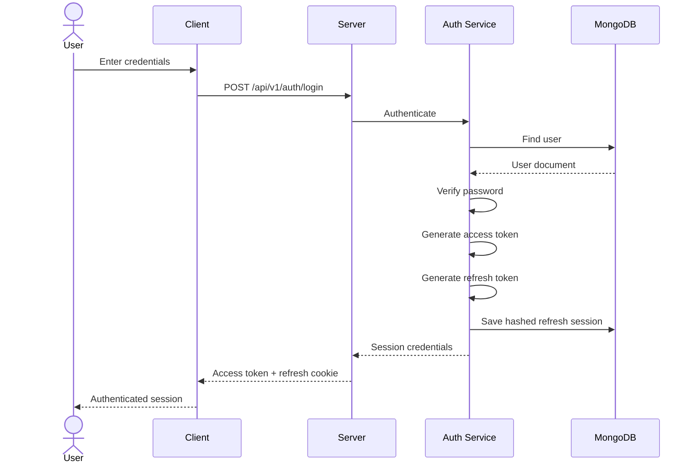

## 9.3 Token Refresh Flow

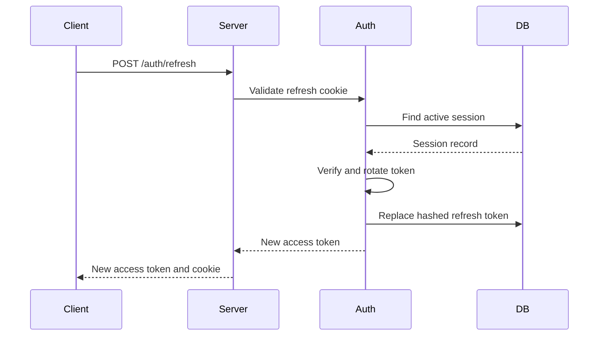

## 9.4 RBAC

Initial roles:

- Customer
- Admin

Possible future roles:

- Super Admin
- Inventory Manager
- Order Manager
- Support Agent

Example permissions:

| Operation | Customer | Admin |
| --- | --- | --- |
| View products | Yes | Yes |
| Add to cart | Yes | Yes |
| Place order | Yes | Yes |
| View own orders | Yes | Yes |
| Manage products | No | Yes |
| Manage categories | No | Yes |
| Manage users | No | Yes |
| Manage inventory | No | Yes |

Authorization must check:

1. User identity.
2. Role or permission.
3. Resource ownership.
4. Resource state.
5. Operation-specific business rules.

---

# 10. Payment Gateway Architecture

## 10.1 Payment Architecture

Payment processing must be server-controlled.

The browser must never be trusted to confirm successful payment.

Recommended architecture:

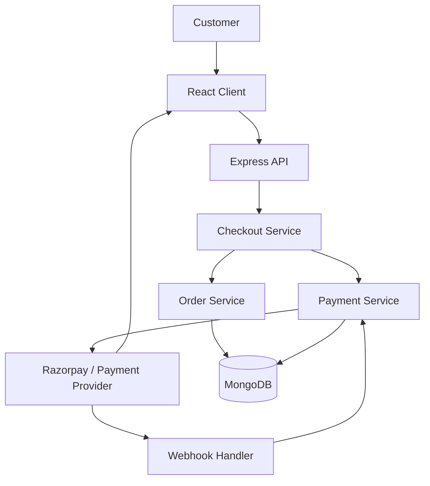

## 10.2 Payment Lifecycle

1. Customer confirms checkout.
2. Server validates cart and address.
3. Server calculates the final amount.
4. Server reserves inventory.
5. Server creates a pending order.
6. Server creates a payment attempt.
7. Server requests a provider order.
8. Client completes provider checkout.
9. Client submits payment verification information.
10. Server verifies the provider signature.
11. Provider sends a webhook.
12. Server verifies the webhook signature.
13. Server processes the event idempotently.
14. Payment and order states are reconciled.
15. Customer receives confirmation.

## 10.3 Payment Sequence Diagram

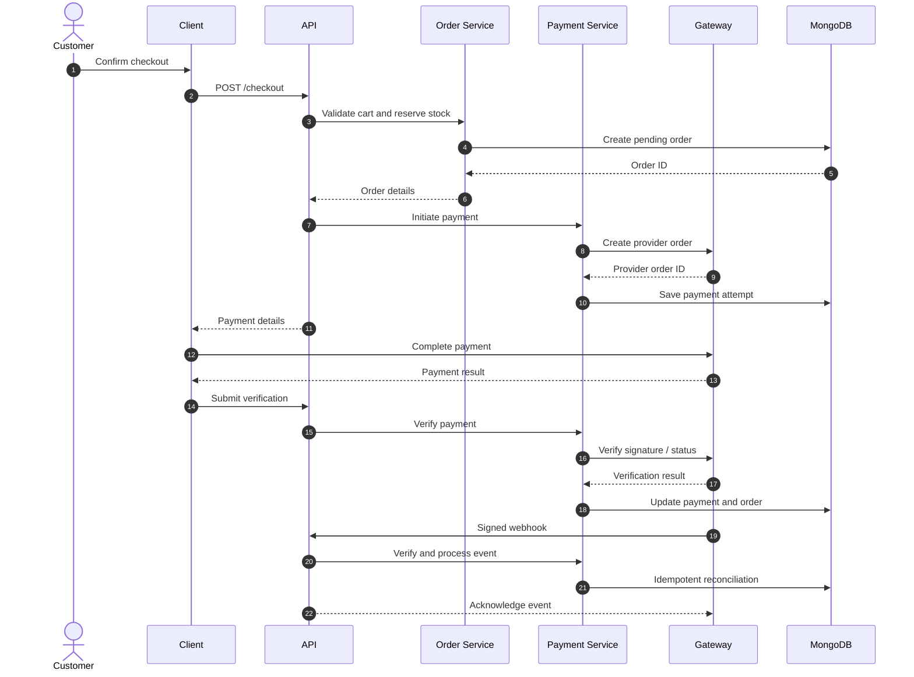

## 10.4 Payment States

- CREATED
- PENDING
- AUTHORIZED
- CAPTURED
- FAILED
- EXPIRED
- REFUND_PENDING
- PARTIALLY_REFUNDED
- REFUNDED

Payment states must be separate from order states.

## 10.5 Idempotency

Every payment operation must have a unique idempotency key.

The system must:

- Reject duplicate payment initiation requests with conflicting payloads.
- Store provider event IDs under a unique index.
- Prevent repeated webhook processing from applying business effects twice.
- Make refund operations idempotent.
- Reconcile provider status when events arrive out of order.

## 10.6 Payment Security

- Never store card numbers or CVV.
- Use provider-hosted checkout or tokenization.
- Verify signatures on the server.
- Keep gateway secrets in secret storage.
- Use HTTPS.
- Validate payment amount and currency against the persisted order.
- Log payment identifiers, not sensitive credentials.

---

# 11. Database Architecture

## 11.1 Database Choice

MongoDB is the primary persistence layer.

Mongoose provides:

- Schema definitions.
- Validation.
- Indexes.
- Middleware.
- Document relationships.
- Transaction support.

Use MongoDB transactions for workflows that must update multiple documents atomically, on a replica-set or sharded deployment.

## 11.2 Main Collections

| Collection | Purpose |
| --- | --- |
| users | User accounts |
| sessions | Refresh sessions |
| products | Product catalog |
| categories | Product categories |
| carts | Shopping carts |
| wishlists | Saved products |
| addresses | Customer addresses |
| inventory_movements | Stock history |
| inventory_reservations | Temporary stock reservations |
| orders | Customer orders |
| payments | Payment attempts |
| payment_events | Webhook event records |
| refunds | Refund records |
| coupons | Discount coupons |
| reviews | Product reviews |
| notifications | In-app notifications |
| audit_logs | Administrative audit trail |

## 11.3 Entity Relationship Diagram

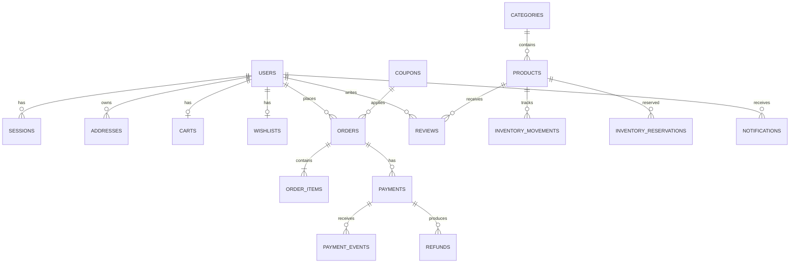

## 11.4 User Schema

```javascript
{
    _id: ObjectId,
    name: String,
    email: String,
    password: String,
    role: String,
    isVerified: Boolean,
    isActive: Boolean,
    createdAt: Date,
    updatedAt: Date
}
```

Constraints:

- Unique normalized email.
- Password stored as a strong password hash.
- Role restricted to allowed values.
- Never allow public registration to assign an admin role.

## 11.5 Product Schema

```javascript
{
    _id: ObjectId,
    name: String,
    slug: String,
    description: String,
    brand: String,
    category: ObjectId,
    price: Number,
    discountedPrice: Number,
    stock: Number,
    images: [{
        url: String,
        alt: String
    }],
    rating: Number,
    numReviews: Number,
    isFeatured: Boolean,
    isActive: Boolean,
    createdAt: Date,
    updatedAt: Date
}
```

Constraints:

- Unique slug.
- Non-negative price and stock.
- Discounted price cannot exceed regular price.
- Rating must remain within 0–5.
- Category reference must be valid.

For production, use integer minor currency units (for example, paise) rather than floating-point arithmetic for monetary values. Keep a currency code with monetary amounts.

## 11.6 Category Schema

```javascript
{
    _id: ObjectId,
    name: String,
    slug: String,
    parent: ObjectId,
    description: String,
    image: String,
    isActive: Boolean,
    createdAt: Date,
    updatedAt: Date
}
```

## 11.7 Cart Schema

```javascript
{
    _id: ObjectId,
    user: ObjectId,
    items: [{
        product: ObjectId,
        quantity: Number
    }],
    updatedAt: Date
}
```

Cart prices are calculated from current product data, not trusted from the browser.

## 11.8 Order Schema

```javascript
{
    _id: ObjectId,
    orderNumber: String,
    user: ObjectId,
    items: [{
        product: ObjectId,
        name: String,
        sku: String,
        quantity: Number,
        unitPriceMinor: Number,
        subtotalMinor: Number
    }],
    addressSnapshot: Object,
    currency: String,
    subtotalMinor: Number,
    discountMinor: Number,
    taxMinor: Number,
    shippingMinor: Number,
    totalMinor: Number,
    status: String,
    paymentStatus: String,
    coupon: ObjectId,
    createdAt: Date,
    updatedAt: Date
}
```

Order items and address should be snapshots so historical orders do not change when catalog or address data changes.

## 11.9 Payment Schema

```javascript
{
    _id: ObjectId,
    order: ObjectId,
    user: ObjectId,
    provider: String,
    providerOrderId: String,
    providerPaymentId: String,
    amountMinor: Number,
    currency: String,
    status: String,
    idempotencyKey: String,
    createdAt: Date,
    updatedAt: Date
}
```

## 11.10 Indexing Strategy

| Collection | Index |
| --- | --- |
| users | Unique email |
| products | Unique slug |
| products | Category + isActive |
| products | isFeatured + isActive |
| categories | Unique slug |
| carts | Unique user |
| wishlists | Unique user |
| orders | User + createdAt |
| orders | Unique orderNumber |
| payments | Provider + providerOrderId |
| payment_events | Unique provider + event ID |
| sessions | Unique token hash |
| inventory_reservations | Expiration time / TTL where safe |
| reviews | Product + createdAt |

TTL indexes are appropriate only for data whose expiration semantics are understood. Do not TTL-delete financial records or payment audit history.

## 11.11 Data Consistency

Use:

- MongoDB transactions for multi-document critical workflows.
- Atomic conditional stock updates.
- Unique indexes for duplicate prevention.
- Idempotency keys for payment and order operations.
- Immutable order snapshots.
- Scheduled reconciliation jobs.
- Explicit state transitions.

Avoid assuming that a sequence of independent MongoDB writes is atomic.

---

# 12. API Architecture

Base URL:

```text
/api/v1
```

## 12.1 Authentication APIs

| Method | Endpoint | Access |
| --- | --- | --- |
| POST | `/auth/register` | Public |
| POST | `/auth/login` | Public |
| POST | `/auth/refresh` | Refresh cookie |
| POST | `/auth/logout` | Authenticated |
| POST | `/auth/forgot-password` | Public |
| POST | `/auth/reset-password` | Reset token |
| GET | `/auth/me` | Authenticated |

## 12.2 User APIs

| Method | Endpoint | Access |
| --- | --- | --- |
| GET | `/users/me` | Customer |
| PATCH | `/users/me` | Customer |
| PATCH | `/users/me/password` | Customer |
| GET | `/users/me/addresses` | Customer |
| POST | `/users/me/addresses` | Customer |
| PATCH | `/users/me/addresses/:id` | Owner |
| DELETE | `/users/me/addresses/:id` | Owner |

## 12.3 Product APIs

| Method | Endpoint | Access |
| --- | --- | --- |
| GET | `/products` | Public |
| GET | `/products/:id` | Public |
| GET | `/products/slug/:slug` | Public |
| POST | `/products` | Admin |
| PATCH | `/products/:id` | Admin |
| DELETE | `/products/:id` | Admin |
| GET | `/admin/products` | Admin |

## 12.4 Category APIs

| Method | Endpoint | Access |
| --- | --- | --- |
| GET | `/categories` | Public |
| GET | `/categories/:id` | Public |
| POST | `/categories` | Admin |
| PATCH | `/categories/:id` | Admin |
| DELETE | `/categories/:id` | Admin |

## 12.5 Cart APIs

| Method | Endpoint | Access |
| --- | --- | --- |
| GET | `/cart` | Customer |
| POST | `/cart/items` | Customer |
| PATCH | `/cart/items/:productId` | Customer |
| DELETE | `/cart/items/:productId` | Customer |
| DELETE | `/cart` | Customer |

## 12.6 Wishlist APIs

| Method | Endpoint | Access |
| --- | --- | --- |
| GET | `/wishlist` | Customer |
| POST | `/wishlist/items` | Customer |
| DELETE | `/wishlist/items/:productId` | Customer |

## 12.7 Checkout APIs

| Method | Endpoint | Access |
| --- | --- | --- |
| POST | `/checkout/quote` | Customer |
| POST | `/checkout` | Customer |

Checkout requests must contain product identifiers, quantities, address selection, and any applicable coupon code. The server recalculates the amount.

## 12.8 Order APIs

| Method | Endpoint | Access |
| --- | --- | --- |
| GET | `/orders` | Customer |
| GET | `/orders/:id` | Owner/Admin |
| POST | `/orders/:id/cancel` | Owner, if eligible |
| GET | `/admin/orders` | Admin |
| PATCH | `/admin/orders/:id/status` | Admin |

Do not expose unrestricted order status updates.

## 12.9 Payment APIs

| Method | Endpoint | Access |
| --- | --- | --- |
| POST | `/payments/initiate` | Customer |
| POST | `/payments/verify` | Customer |
| GET | `/payments/:id` | Owner/Admin |
| POST | `/payments/webhooks/razorpay` | Provider signature |
| POST | `/payments/:id/refunds` | Authorized Admin |

## 12.10 Coupon APIs

| Method | Endpoint | Access |
| --- | --- | --- |
| POST | `/coupons/validate` | Customer |
| GET | `/admin/coupons` | Admin |
| POST | `/admin/coupons` | Admin |
| PATCH | `/admin/coupons/:id` | Admin |
| DELETE | `/admin/coupons/:id` | Admin |

## 12.11 Review APIs

| Method | Endpoint | Access |
| --- | --- | --- |
| GET | `/products/:id/reviews` | Public |
| POST | `/products/:id/reviews` | Eligible Customer |
| PATCH | `/reviews/:id` | Owner |
| DELETE | `/reviews/:id` | Owner/Admin |

## 12.12 Pagination

Example:

```text
GET /api/v1/products?page=1&limit=20&sort=price&order=asc
```

Response:

```json
{
    "success": true,
    "data": [],
    "meta": {
        "page": 1,
        "limit": 20,
        "total": 100,
        "totalPages": 5
    }
}
```

Validate pagination limits and sort fields using allowlists. Use cursor pagination for large, frequently changing collections when appropriate.

---

# 13. Security Architecture

## 13.1 Password Security

Use bcrypt or Argon2id with production-appropriate work factors.

Never store plaintext passwords.

## 13.2 JWT Security

- Short-lived access tokens.
- Rotating refresh tokens.
- Refresh token hashes stored server-side.
- Session revocation.
- Token expiry validation.
- Strong signing secrets.
- Explicit token issuer and audience validation.

## 13.3 Input Validation

Use Zod for:

- Request bodies.
- Query parameters.
- Route parameters.
- Configuration variables.

Reject unknown or unexpected fields where appropriate.

## 13.4 Injection Protection

- Use Mongoose query objects built from validated fields.
- Never pass arbitrary user-controlled MongoDB operators into queries.
- Allowlist sort and filter fields.
- Avoid unsafe dynamic query construction.
- Sanitize rich text if rich text is supported.

## 13.5 XSS Protection

- Escape untrusted content.
- Avoid unsafe HTML rendering.
- Use Content Security Policy.
- Validate uploaded file types.
- Keep dependencies updated.

## 13.6 CSRF Protection

If authentication relies on cookies:

- Use SameSite cookie settings.
- Implement CSRF tokens or an equivalent robust origin-check strategy.
- Validate Origin/Referer where appropriate.
- Protect state-changing endpoints.

## 13.7 CORS

Allow only trusted client origins.

Never use unrestricted production CORS with credentialed requests.

## 13.8 Rate Limiting

Apply stricter rate limits to:

- Login.
- Registration.
- Password reset.
- Payment initiation.
- Coupon validation.
- Public search.

## 13.9 Security Headers

Use Helmet and an appropriate Content Security Policy.

## 13.10 OWASP Considerations

| Risk | Mitigation |
| --- | --- |
| Broken Access Control | Backend RBAC and ownership checks |
| Cryptographic Failures | Secure hashing, TLS, secret management |
| Injection | Validation and safe query construction |
| Insecure Design | Threat modeling and workflow validation |
| Security Misconfiguration | Secure defaults and environment separation |
| Vulnerable Components | Dependency scanning |
| Authentication Failures | Token rotation and session revocation |
| Data Integrity Failures | Signature verification and idempotency |
| Logging Failures | Structured security audit logs |
| SSRF | Outbound destination allowlists and network controls |

---

# 14. Caching and Background Processing

## 14.1 Redis Caching

Cache candidates:

- Product details.
- Featured products.
- Category lists.
- Public catalog queries.
- Frequently accessed configuration.

Cache invalidation must occur after relevant product/category changes.

Do not cache sensitive user-specific data without strict isolation.

## 14.2 Cache-Aside Pattern

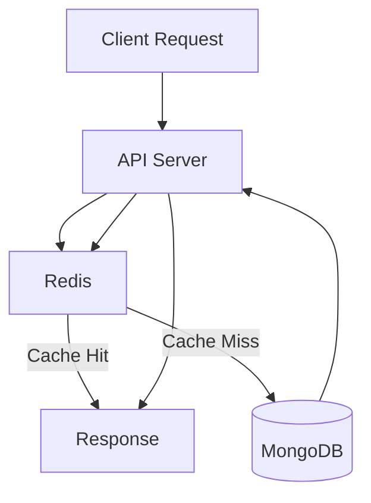

## 14.3 Background Jobs

Use BullMQ with Redis for asynchronous tasks.

Examples:

- Email delivery.
- SMS delivery.
- Order confirmation.
- Payment reconciliation.
- Expired inventory reservation cleanup.
- Abandoned cart notifications.
- Analytics aggregation.

Jobs must support retries, backoff, idempotency, and dead-letter handling.

## 14.4 Outbox Pattern

For important business events, persist an outbox event in the same database transaction as the business update.

A worker later publishes the event and marks it processed.

This prevents losing notifications or integration events when the process crashes after committing a business operation.

---

# 15. Scalability and Performance

## 15.1 Horizontal Scaling

Run multiple stateless API instances behind a load balancer.

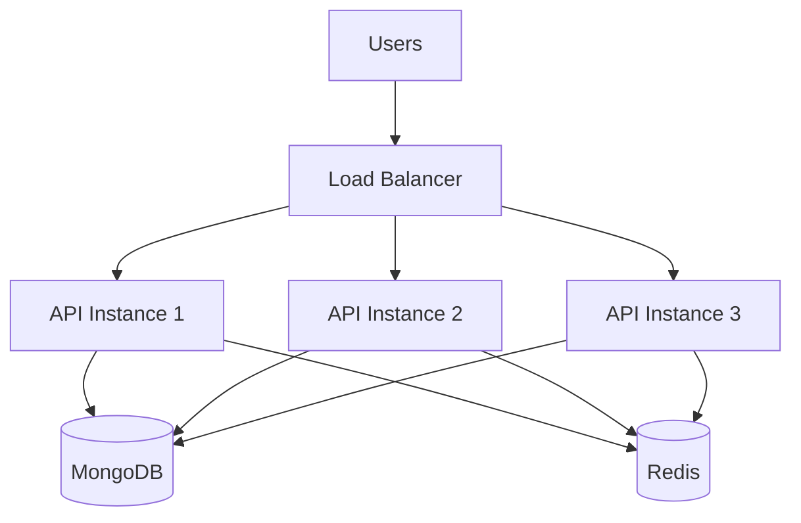

## 15.2 Database Optimization

- Add indexes based on query patterns.
- Avoid unbounded document growth.
- Use projections to return required fields.
- Use pagination.
- Monitor slow queries.
- Limit expensive aggregation operations.
- Use connection pooling.
- Avoid N+1 query patterns.

## 15.3 Image Optimization

- Store images in object storage.
- Deliver images through a CDN.
- Generate multiple resolutions.
- Use WebP or AVIF where supported.
- Lazy-load non-critical images.
- Validate image size and MIME type.

## 15.4 Inventory Concurrency

Use atomic conditional stock updates.

A stock reservation should only succeed when sufficient stock exists.

For multi-product orders:

1. Start a transaction.
2. Reserve each requested item.
3. Abort if any reservation fails.
4. Create order and reservation records.
5. Commit.
6. Release expired reservations through a background worker.

Do not rely on reading stock and later writing a decremented value without an atomic condition.

## 15.5 Database Connection Management

- Reuse a shared Mongoose connection per process.
- Configure pool limits according to deployment size.
- Handle transient errors.
- Use graceful shutdown.
- Avoid creating a new connection per request.

---

# 16. DevOps and Infrastructure

## 16.1 Deployment Architecture

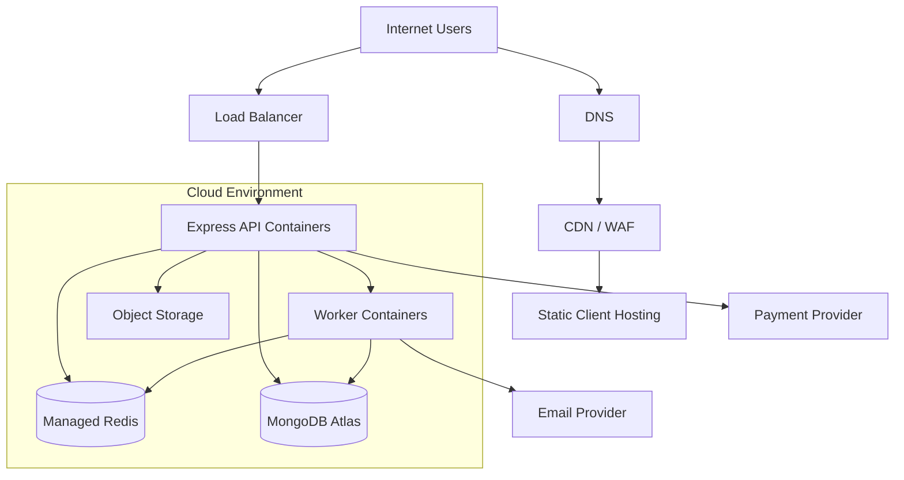

## 16.2 Docker

Use separate Docker images for:

- Client.
- Server.
- Worker.

## 16.3 Docker Compose

Development services:

```yaml
services:
  client:
    build: ./client
    ports:
      - "5173:5173"
    depends_on:
      - server

  server:
    build: ./server
    ports:
      - "5000:5000"
    environment:
      NODE_ENV: development
      MONGODB_URI: mongodb://mongodb:27017/vendora
      REDIS_URL: redis://redis:6379
    depends_on:
      - mongodb
      - redis

  mongodb:
    image: mongo:8
    volumes:
      - mongodb_data:/data/db

  redis:
    image: redis:7-alpine

volumes:
  mongodb_data:
```

This is a starting development configuration. Enable a MongoDB replica set for transaction-dependent development and tests. Production deployments should use managed infrastructure, secure credentials, private networking, and health checks.

## 16.4 CI/CD Pipeline

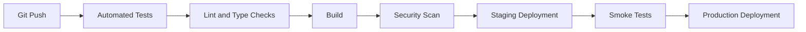

## 16.5 Environments

| Environment | Purpose |
| --- | --- |
| Development | Local development |
| Testing | Automated tests |
| Staging | Production-like verification |
| Production | Live application |

## 16.6 Backup Strategy

- Enable automated MongoDB backups.
- Define retention policies.
- Encrypt backups.
- Test restoration periodically.
- Document recovery procedures.
- Define recovery time objective (RTO) and recovery point objective (RPO).

## 16.7 Rollback Strategy

- Deploy immutable container images.
- Keep the previous known-good version.
- Use health checks.
- Roll back failed releases.
- Use backward-compatible database changes.
- Avoid destructive schema changes without a migration plan.

---

# 17. Monitoring and Logging

## 17.1 Logging

Use structured JSON logs.

Important fields:

- Timestamp.
- Log level.
- Request ID.
- User ID where appropriate.
- HTTP method.
- Route.
- Response status.
- Latency.
- Error code.

Never log passwords, access tokens, refresh tokens, card details, or secrets.

## 17.2 Monitoring

Monitor:

- API latency.
- Error rate.
- Request throughput.
- CPU and memory.
- Database connections.
- Slow queries.
- Redis availability.
- Queue depth.
- Failed jobs.
- Payment success/failure rate.
- Webhook processing delay.

## 17.3 Health Checks

Recommended endpoints:

```text
GET /health/live
GET /health/ready
```

Liveness checks whether the process is alive.

Readiness checks whether the process can safely serve traffic, including required dependency availability.

---

# 18. Testing Strategy

## 18.1 Unit Testing

Test:

- Services.
- Validators.
- Utility functions.
- Pricing calculations.
- Permission policies.
- State transitions.

## 18.2 Integration Testing

Test:

- API routes.
- MongoDB operations.
- Authentication middleware.
- Inventory transactions.
- Payment service adapters.

## 18.3 API Testing

Use Postman or automated API tests.

Test:

- Successful requests.
- Invalid payloads.
- Unauthorized requests.
- Forbidden requests.
- Duplicate requests.
- Missing resources.
- Concurrent operations.

## 18.4 End-to-End Testing

Use Playwright.

Important flows:

1. Registration.
2. Login.
3. Product browsing.
4. Cart operations.
5. Checkout.
6. Payment.
7. Order history.
8. Admin product creation.

## 18.5 Payment Testing

Use provider sandbox mode.

Test:

- Successful payment.
- Failed payment.
- Pending payment.
- Invalid signature.
- Duplicate webhook.
- Out-of-order webhook.
- Refund.
- Payment timeout.
- Payment reconciliation.

## 18.6 Load Testing

Use k6 or an equivalent tool.

Test:

- Product listing.
- Product detail.
- Search.
- Login.
- Cart operations.
- Checkout concurrency.
- Inventory contention.

---

# 19. Error Handling

Use centralized error handling.

Error categories:

| Error | HTTP Status |
| --- | --- |
| ValidationError | 400 / 422 |
| AuthenticationError | 401 |
| AuthorizationError | 403 |
| NotFoundError | 404 |
| ConflictError | 409 |
| RateLimitError | 429 |
| InternalServerError | 500 |

The error middleware should:

1. Normalize known errors.
2. Assign stable error codes.
3. Attach request IDs.
4. Log unexpected errors.
5. Hide internal implementation details.
6. Return consistent JSON.

---

# 20. Project Folder Structure

```text
Vendora/
├── client/
│   ├── public/
│   ├── src/
│   ├── tests/
│   ├── package.json
│   └── vite.config.ts
│
├── server/
│   ├── src/
│   ├── tests/
│   ├── package.json
│   └── Dockerfile
│
├── infrastructure/
│   ├── docker/
│   ├── nginx/
│   ├── monitoring/
│   └── deployment/
│
├── docs/
│   ├── API.md
│   ├── DATABASE.md
│   ├── PAYMENT_FLOW.md
│   └── SECURITY.md
│
├── docker-compose.yml
├── .gitignore
├── README.md
└── SYSTEM_DESIGN.md
```

---

# 21. Implementation Roadmap

## Phase 1 — Architecture Foundation

Objectives:

- Establish client/server separation.
- Configure Express.
- Configure React.
- Configure MongoDB.
- Establish environment configuration.
- Implement centralized error handling.
- Establish API response conventions.

Deliverables:

- Running client.
- Running server.
- Database connectivity.
- Health endpoints.

Completion criteria:

Client can successfully communicate with server and the server can access MongoDB.

## Phase 2 — Authentication and RBAC

Objectives:

- Registration.
- Login.
- JWT authentication.
- Refresh sessions.
- Logout.
- Role-based authorization.
- Protected APIs.

Deliverables:

- Authentication module.
- User model.
- Session model.
- Authorization middleware.

Completion criteria:

Public users cannot execute administrator operations.

## Phase 3 — Product Catalog

Objectives:

- Product CRUD.
- Category CRUD.
- Product listing.
- Product details.
- Search.
- Filtering.
- Sorting.
- Pagination.

Deliverables:

- Product module.
- Category module.
- Admin catalog interfaces.

Completion criteria:

Products can be managed by administrators and browsed by customers.

## Phase 4 — Shopping System

Objectives:

- Cart.
- Wishlist.
- Address management.
- Inventory.
- Checkout.

Deliverables:

- Cart module.
- Wishlist module.
- Inventory module.
- Checkout module.

Completion criteria:

Customer can build a cart and create a pending order using server-calculated totals.

## Phase 5 — Orders and Payments

Objectives:

- Order management.
- Payment gateway integration.
- Payment verification.
- Webhooks.
- Refunds.
- Cancellation.

Deliverables:

- Order module.
- Payment adapter.
- Webhook handler.
- Refund workflow.

Completion criteria:

Payment status is verified by the backend and duplicate payment events cannot create duplicate effects.

## Phase 6 — Additional Features

Objectives:

- Coupons.
- Reviews.
- Ratings.
- Notifications.
- Admin analytics.

Deliverables:

- Coupon module.
- Review module.
- Notification worker.
- Admin dashboard.

Completion criteria:

All major business workflows are implemented and tested.

## Phase 7 — Production Readiness

Objectives:

- Docker.
- Redis.
- CI/CD.
- Security hardening.
- Monitoring.
- Backups.
- Load testing.

Deliverables:

- Production containers.
- CI/CD pipeline.
- Monitoring dashboard.
- Backup and restore procedure.

Completion criteria:

Staging passes security, integration, performance, and deployment verification.

---

# 22. Future Enhancements

Potential future improvements:

- Microservices.
- Dedicated search engine.
- Event-driven architecture.
- Kafka or another event streaming platform.
- Recommendation engine.
- Multi-vendor marketplace.
- Multi-currency support.
- International payment providers.
- Advanced analytics.
- Distributed tracing.
- Multi-region deployment.
- Read replicas and database sharding.

These features should be introduced only when justified by actual business requirements and measurable operational constraints.

---

# 23. Engineering Standards

## 23.1 Code Organization

- Follow separation of concerns.
- Keep controllers thin.
- Keep business logic inside services.
- Encapsulate database operations.
- Use reusable components.
- Avoid circular dependencies.
- Keep modules independently understandable.

## 23.2 API Standards

- Use REST conventions.
- Version APIs.
- Validate every request.
- Use consistent response structures.
- Implement pagination.
- Use stable error codes.
- Document endpoints.

## 23.3 Security Standards

- Never trust client-supplied business values.
- Never expose secrets.
- Enforce authorization on the backend.
- Verify payment signatures.
- Implement rate limiting.
- Keep dependencies updated.
- Audit sensitive administrative actions.

## 23.4 Database Standards

- Use appropriate indexes.
- Validate persisted data.
- Use transactions for critical multi-document workflows.
- Prevent duplicate operations with unique constraints.
- Preserve historical order snapshots.
- Maintain audit records for financial and administrative operations.

## 23.5 Development Standards

- Use Git feature branches.
- Write meaningful commit messages.
- Review changes before merging.
- Run tests before deployment.
- Maintain `.env.example`.
- Keep technical documentation updated.
- Avoid introducing unnecessary dependencies.

---

# Final Architecture Decision

Vendora will use:

**Client**

- React
- TypeScript
- Redux Toolkit
- Zustand
- React Router
- Axios

**Server**

- Node.js
- Express.js
- JavaScript ES Modules
- Mongoose
- Zod
- JWT
- RBAC

**Infrastructure**

- MongoDB
- Redis
- Docker
- Nginx
- GitHub Actions
- Cloud object storage
- CDN

**Payment**

- Razorpay initially
- Provider-independent payment adapter

**Architecture**

- Client–Server Architecture
- Modular Monolithic Backend
- REST API
- Repository and Service Layers
- Background Job Processing

The client and server will remain separate applications, independently maintainable and deployable.

The backend will remain a modular monolith until measurable requirements justify service extraction.

This architecture provides a practical foundation for building, testing, deploying, and scaling Vendora without introducing unnecessary infrastructure complexity during initial development.

---

**Document Status:** Architecture Blueprint  
**Project:** Vendora  
**File:** SYSTEM_DESIGN.md